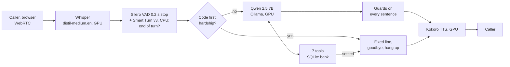

# Local voice agent for EMI reminder calls

A voice bot that phones a borrower about an overdue loan instalment, checks who it's talking to, and ends with
a payment promise, a callback, a dispute or a hand-off to a person. Every model runs on one laptop GPU
(RTX 3070 Ti, 8 GB): no cloud, no API keys, ₹0 per call.

What sets it apart is that it's **measured**. Latency comes per stage, turn-taking settings are compared on real
calls, and a test bench phones the live bot 27 times and scores every call in code.

| | Result |
|---|---|
| Test bench, 9 scenarios × 3 | **27 / 27 calls passed** (14 / 27 before code took over the call endings) |
| Voice to voice (caller stops → bot audio) | **p50 1.3 s, p95 1.8 s** over 100 replies; slowest 1.9 s |
| Caller cuts in | bot audio stops 0.65–0.70 s later |
| Loan details before the date of birth matched | 0 of 27 calls |
| GPU memory, whole card | 6.5 GB of 8 |

## One call
A test-bench call, as the caller heard it (Whisper tiny.en hears "Asha" as "a shaft"):
```
bot   : Hello, this is a shaft from Kosha Finance. This call is recorded. Am I speaking with Rahul Sharma?
caller: Yes, this is Rahul speaking.
bot   : I understand. Could you please provide me with your date of birth to confirm your identity?
caller: It's the fifth of March, nineteen ninety.
bot   : Thank you for confirming. 4,500 rupees is due on your personal loan since the 6th of October.
        When will you be able to pay?
caller: Okay. I can pay the full amount this Friday.
bot   : Great! You said you can pay 4,500 rupees this Friday. Is that correct?
caller: Yes, that's right.
bot   : Thank you. I have recorded 4,500 rupees by Friday. The 23rd of October. Is there anything else?
caller: No, that's all. Thank you.
bot   : Thank you for your time. Goodbye.                    (and hangs up)
```
The call leaves `calls/<id>.json`, built from what the tools accepted, never from what the LLM said:
`{"outcome": "promise_to_pay", "ended_by": "agent", "promise_date": "2026-10-23", "amount": 4500, "verified_after_caller_turns": 2, ...}`.

## How it works

Built on [Pipecat](https://github.com/pipecat-ai/pipecat) 1.12. More detail, including where code takes over from
the LLM: [docs/architecture.md](docs/architecture.md).

**Design rule: code owns the facts and the rules; the LLM only handles language.**
- Loan details sit behind tools that refuse until the date of birth matches. Before that, the LLM's prompt and
  tool list don't mention the debt at all. RBI rules forbid telling a third party about someone's loan.
- Dates are worked out in code from the caller's words ("this Friday" → `2026-10-23`). Promises are checked in code:
  at most 7 days away, at least 25% of what's due and never more than it.
- Calls are refused outside 08:00–19:00 (the RBI rule for recovery calls).
- The greeting, the recording notice, the amount due and the closing lines are fixed text.
- Every sentence the LLM writes is checked before it's spoken. It's dropped if it mentions the debt before
  verification, writes JSON, states a date no tool gave, or claims something was recorded that wasn't.
- After a settling tool succeeds (dispute, callback, escalation) or the identity check locks, code speaks the
  closing line, says goodbye and hangs up. The LLM doesn't get another turn.
- A caller who mentions hardship (lost job, illness) is handed to a person by code, not left to the LLM.

## Measured
All numbers are from this laptop, 20 Oct 2026. Run guides with the full tables: [docs/guide/](docs/guide/README.md).

**Latency, step by step** (voice to voice, p50 / p95):

| Change | p50 / p95 | |
|---|---|---|
| First working call flow | 2406 / 4573 ms | |
| Fixed lines spoken one sentence at a time | 1831 / 3093 ms | Kokoro starts on the first sentence |
| Kokoro moved to the GPU | 1304 / 2445 ms | speech synthesis 699 → 331 ms p50 |
| Code ends the call (no slow LLM loops) | 1316 / 1783 ms | test bench, 98 replies |

**Qwen 2.5 7B vs 3B** (12 scripted browser calls each):

| | 7B | 3B |
|---|---|---|
| Voice to voice p50 / p95 | **1831 / 3093 ms** | 2123 / 4007 ms |
| Calls that ended right | **10 / 12** | 7 / 12 |
| Tool calls refused by code | 9 | 18 |
| GPU memory | 5.4 GB | **2.9 GB** |

The 3B is smaller but slower per call: it makes twice as many bad tool calls, and every refusal costs another
LLM turn.

**VAD stop time** (how long the caller is quiet before Smart Turn decides): 0.2 s is the fastest, but splits 23
of 53 caller lines in two. 0.4 s splits 8, but adds about 0.3 s to every reply. Kept 0.2 s; the code joins
consecutive caller turns.

**Test bench** ([testbench/](testbench/)). A second WebRTC peer (aiortc) phones the bot. It hears it through
Whisper tiny.en on the CPU, answers from regex rules with a different Kokoro voice, and scores the call record, the
bank rows and the transcript in code:

| Scenario | What the caller does | Must end with | Passed |
|---|---|---|---|
| happy | pays this Friday | promise of 4500, right date | 3 / 3 |
| already_paid | says she paid | dispute, no promise | 3 / 3 |
| hardship | lost his job, can pay 500 | escalated, note has the 500 | 3 / 3 |
| dispute | the amount is wrong | dispute | 3 / 3 |
| call_later | busy, call at 11 am tomorrow | callback at the right time | 3 / 3 |
| wrong_person | someone else answers | callback, no loan details said | 3 / 3 |
| wrongdob | three wrong dates of birth | locked, no loan details said | 3 / 3 |
| interrupts | cuts the bot off mid-sentence | promise; bot stops in < 1 s | 3 / 3 |
| silence | goes quiet for 20 s | bot asks "Are you still there?" within 12 s | 3 / 3 |

Every scenario also checks that there were no threats and no debt talk before verification. The first run passed
14 / 27. Four early failures were bugs in the bench itself. The rest were the LLM not ending a call whose business
was done, which is what moved into code.

The hardship closing line takes 1.7 s, not 1.3 s. That's on purpose: code waits 0.8 s for the caller to finish, so
the bot doesn't talk over "I can only pay 500 this week". Without that wait, the 500 never reached the person
taking over. In the bench, the 0.8 s wait plus TTS shows up as that line's "voice to voice" time; it isn't LLM time.

## Honest limits
- **27 / 27 is this bench, not a pass rate for real callers.** Nine scenarios, one synthetic English voice, clean
  audio, no phone codec. The hardship words and closing lines were written with these scenarios in view.
- **The LLM still slips; the guards catch it.** In one bench call Qwen said "this Friday, 2026-10-20" (a Tuesday),
  and the date guard silenced it. In another, it said "End of call, outcome is promised to pay." aloud instead of
  calling `end_call`; no guard caught it, and the bench passed the call (1 of 54 calls across the last two runs).
  The guards work on words, so they're coarse: they can block a harmless sentence, and they'd miss a threat
  phrased politely.
- **Hardship detection is an English regex.** "Things are tight since the factory shut" isn't matched; the LLM's
  prompt rule is the fallback, and on the 7B it ignored that rule in 3 of 3 bench calls before code took over.
- **The 0.8 s hardship wait is tuned on one voice.** A caller who stops to think for longer is talked over again.
- **Silence ends the call after about 30 s** (8 s, "Are you still there?" twice). A caller looking for a bank
  statement gets hung up on.
- **Browser, not a phone line.** No SIP or telephony. Latency over a real phone network would be higher.
- **English only.** Hinglish would need a different STT and TTS.

## Run it
Needs Windows 11, an NVIDIA GPU with 8 GB, [uv](https://docs.astral.sh/uv/) and [Ollama](https://ollama.com).
```powershell
ollama pull qwen2.5:7b
uv sync
uv run python -m scripts.check_env        # GPU, CUDA DLLs, Ollama, models: all green or a fix
uv run python -m scripts.seed_bank        # fake bank: 6 customers, one per scenario
uv run python -m agent.bot                # open http://localhost:7860, allow the mic, Connect
```
The browser calls customer 1 (Rahul Sharma, date of birth 5 March 1990). To call someone else, set `$env:CUSTOMER`
before starting the bot; the six customers are in [agent/bank.py](agent/bank.py), e.g. `$env:CUSTOMER=3` is Arjun
Mehta, who lost his job. Outside 08:00–19:00 the bot refuses to call; for a dev test, set `$env:ALLOW_ANY_HOUR=1`.
```powershell
uv run pytest                             # 313 tests, no GPU or models needed
uv run python -m testbench.run --runs 3   # the 27 calls, about 40 minutes
uv run python -m scripts.latency_report   # p50 / p95 per stage from the calls so far
```
Step-by-step guides, with real output and what to do when it breaks: [docs/guide/](docs/guide/README.md).

## Layout
```
agent/        bot.py (pipeline), tools.py, call_state.py (rules, guards, call record), hardship.py,
              prompts.py, speech.py (numbers and dates into words), bank.py, metrics.py, config.py
testbench/    run.py, caller.py (the phoning peer), scenario.py, score.py, scenarios/*.toml
scripts/      check_env, seed_bank, latency_report, try_stt / try_llm / try_tts
tests/        pytest, models faked
docs/guide/   how to run and check each step
```
All names, phone numbers and loans in the fake bank are made up.

## License
The code is [MIT](LICENSE). The models are downloaded at run time and keep their own licenses: Qwen 2.5 7B
(Apache 2.0), Whisper and Silero VAD (MIT), Kokoro (Apache 2.0), Smart Turn (BSD 2-Clause).
