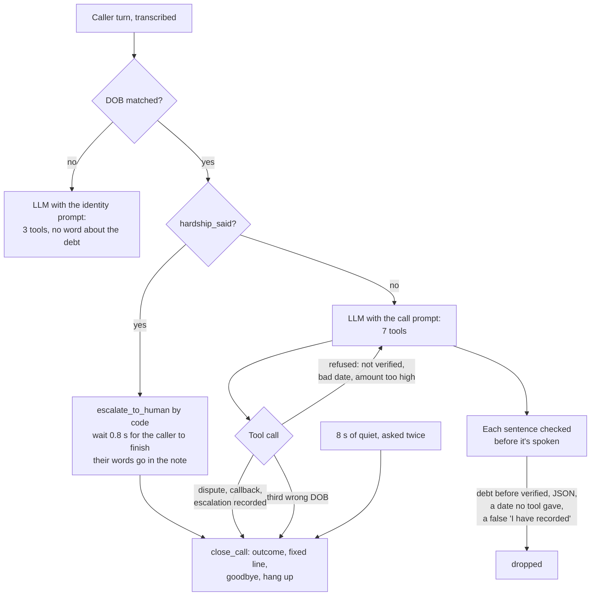

# Architecture

One Python process, one Pipecat pipeline per call, all models on one 8 GB laptop GPU. The browser (or the test
bench's caller) is a WebRTC peer on localhost.

## The pipeline
Frames flow left to right; the processors are listed in [agent/bot.py](../agent/bot.py) under `Pipeline([...])`.

```mermaid
flowchart LR
    in["transport.input<br/>WebRTC audio in"] --> stt["Whisper STT<br/>distil-medium.en, GPU"]
    stt --> ua["User aggregator<br/>Silero VAD + Smart Turn v3<br/>idle timer"]
    ua --> join["JoinCallerTurns<br/>joins split turns;<br/>code may take the turn"]
    join --> llm["Ollama<br/>Qwen 2.5 7B + tools"]
    llm --> tts["Kokoro TTS, GPU<br/>to_words: guards,<br/>numbers into words"]
    tts --> out["transport.output<br/>audio out"]
    out --> played["PlayedText"]
    played --> aa["Assistant aggregator<br/>what was really said"]
```

| Part | Model / where | Why this one |
|---|---|---|
| Voice activity | Silero VAD, CPU, `stop_secs=0.2` | 0.2 s is the fastest; split caller turns are joined in code |
| End of turn | Smart Turn v3 (ONNX), CPU | tells "I lost my job..." (pause) from a finished turn better than a fixed silence |
| Hearing | faster-whisper `distil-medium.en`, CUDA int8 | about 0.15–0.4 s per turn; English only |
| Brain | Qwen 2.5 7B in Ollama | the 3B used half the memory but made twice the bad tool calls |
| Voice | Kokoro `af_heart`, onnxruntime-gpu | about 0.3 s to the first sentence; one sentence at a time |
| Bank | SQLite, [agent/bank.py](../agent/bank.py) | fake customers, loans, payments, and what calls recorded |

## Where code takes over from the LLM
The LLM writes the sentences. Code decides what's true, what's allowed and when the call ends.

| Rule | Code |
|---|---|
| Loan details only after the date of birth matches | `CallTools` refuses; the identity prompt and tool list hold nothing about the debt ([agent/tools.py](../agent/tools.py), [agent/prompts.py](../agent/prompts.py)) |
| Dates from the caller's words, in code | `resolve_day`, `resolve_time`, `resolve_birth_date` ([agent/call_state.py](../agent/call_state.py)) |
| A promise: at most 7 days away, between 25% and 100% of the amount due | `check_promise` ([agent/call_state.py](../agent/call_state.py)); a refusal tells the LLM to ask for the minimum or offer a person |
| Calls only 08:00–19:00 | `within_call_hours`, checked before the call starts |
| Sentences checked before they're spoken | `unsafe_to_say`, run on every sentence inside Kokoro's text transformer |
| The call ends in code after it's settled | `close_call` ([agent/bot.py](../agent/bot.py)) |
| Hardship goes to a person | `hardship_said` + `HardshipWait` ([agent/hardship.py](../agent/hardship.py)) |
| The call record comes from tool results, not the LLM's words | `call_record` ([agent/call_state.py](../agent/call_state.py)) |

## What gets measured
- **Each reply:** Pipecat's `UserBotLatencyObserver` writes one JSON line per reply to `metrics/<call_id>.jsonl`, with
  voice to voice and each stage (turn detection, transcription, LLM, speech synthesis).
  [scripts/latency_report.py](../scripts/latency_report.py) turns them into p50/p95 per stage.
- **Each call:** `calls/<call_id>.json`, with the outcome, the promise, the tool calls with their results, and the
  transcript.
- **The test bench:** [testbench/run.py](../testbench/run.py) restarts the bank before each call, phones the bot,
  and scores the record, the bank rows and the transcript. Results go to `testbench/results/<time>/report.json`,
  with a recording of each call.
